# DSO202 Practical 5 – Environment-Specific Configuration with Kustomize on Kind

## 1. Aim

The aim of this practical was to learn how to manage **one application across several environments** (dev, staging, prod and QA) without copying Kubernetes manifests. I used **Kustomize** to keep a single base and add a small overlay per environment. I then practised the safe delivery workflow:

```
render → diff → apply → verify
```

By the end I was able to:

- render a base and multiple overlays;
- deploy dev/staging/prod without copying the base Deployment or Service;
- use `namespace`, `labels`, `replicas`, `images`, generators and patches;
- observe how a ConfigMap hash triggers a rollout;
- diagnose a Kustomize problem from the rendered output.

## 2. Background

When the same application runs in several environments, the easy approach is to copy `deployment.yaml` into a folder for each environment. This quickly causes **configuration drift**: a fix made in one copy is forgotten in the others, and reviewers have to read whole files to find the one line that differs.

**Kustomize** (built into `kubectl` as `kubectl kustomize` and `kubectl apply -k`) solves this with **bases and overlays**:

| Concept | Meaning in this practical |
|---|---|
| **Base** | The shared Deployment, Service and default web page. It exists **once**. |
| **Overlay** | A small folder per environment that *references* the base and only describes what is different. |
| **Transformers** | `namespace`, `labels`, `replicas`, `images`, `namePrefix` change many resources in a reference-aware way. |
| **Generators** | `configMapGenerator` turns `index.html` into a ConfigMap with a **content hash** in its name. |
| **Patches** | A strategic merge patch or a JSON 6902 patch changes specific fields. |

Kustomize is **template-free**: every file is plain, valid Kubernetes YAML, and the output is just more YAML that I can read before anything reaches the cluster.

## 3. Tools Used

| Tool | Purpose |
|---|---|
| Docker 29.9 | Runs the Kind node containers |
| Kind | Local 3-node Kubernetes cluster (`dso202`, Kubernetes v1.36.1) |
| kubectl v1.37.2 | Cluster access, with built-in **Kustomize v5.8.1** (`-k`, `kubectl kustomize`) |
| nginx:1.27-alpine / 1.27.3-alpine | Small web workload (the target is Kustomize, not app code) |
| diff / curl / tree | Comparing renders, testing the app, showing the repo layout |

## 4. Repository Structure

```
DSO202_Practical5/
├── kind-config.yaml                 # 1 control plane + 2 workers
├── examples/webapp/
│   ├── base/                        # exists ONCE for all environments
│   │   ├── deployment.yaml          # Deployment "webapp" (nginx, mounts web-content)
│   │   ├── service.yaml             # ClusterIP Service "webapp"
│   │   ├── index.html               # default page
│   │   └── kustomization.yaml       # resources + common label + configMapGenerator
│   └── overlays/
│       ├── dev/                     # webapp-dev, 1 replica
│       ├── staging/                 # webapp-staging, 2 replicas, pinned image
│       ├── prod/                    # webapp-prod, 3 replicas, + patch-resources.yaml
│       ├── qa/                      # my own overlay (Task 9), JSON 6902 patch
│       └── sandbox/                 # challenge extension: namePrefix
├── evidence/                        # raw command output captured during the lab
└── screenshots/                     # terminal screenshots used in this report
```

Each overlay contains only `kustomization.yaml`, `namespace.yaml`, its own `index.html` and, where needed, a patch file. **No overlay contains a copy of `deployment.yaml` or `service.yaml`.**

---

## 5. Task 0 – Pre-flight

I created the cluster with the same `kind-config.yaml` as in the earlier practicals:

```bash
kind create cluster --name dso202 --config kind-config.yaml
kubectl cluster-info
kubectl get nodes -o wide
kubectl version --client -o yaml
```

```
Kubernetes control plane is running at https://127.0.0.1:63500
NAME                   STATUS   ROLES           AGE   VERSION
dso202-control-plane   Ready    control-plane   23s   v1.36.1
dso202-worker          Ready    <none>          13s   v1.36.1
dso202-worker2         Ready    <none>          13s   v1.36.1
...
gitVersion: v1.37.2
kustomizeVersion: v5.8.1
```

- The current context is `kind-dso202`, and it reaches the cluster.
- All three nodes are `Ready`.
- `kubectl` includes Kustomize v5.8.1, so `-k` and `kubectl kustomize` are supported.

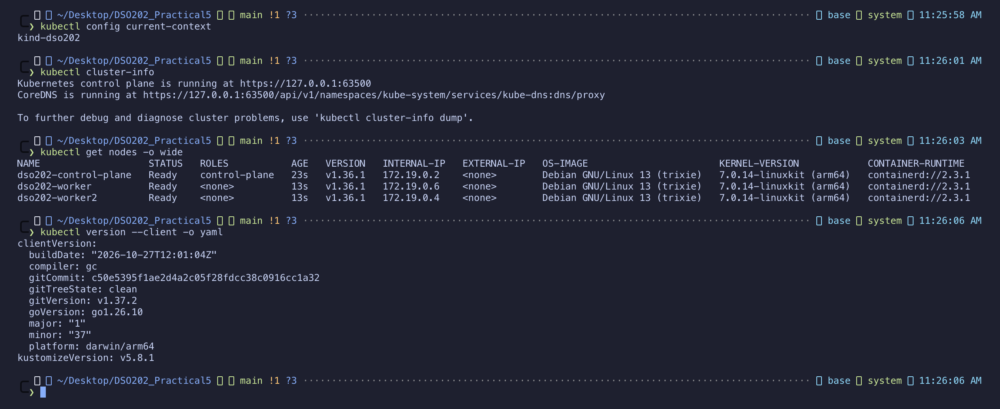

Full output: [evidence/00-preflight.txt](evidence/00-preflight.txt)

---

## 6. Task 1 – Reading the repository before running it

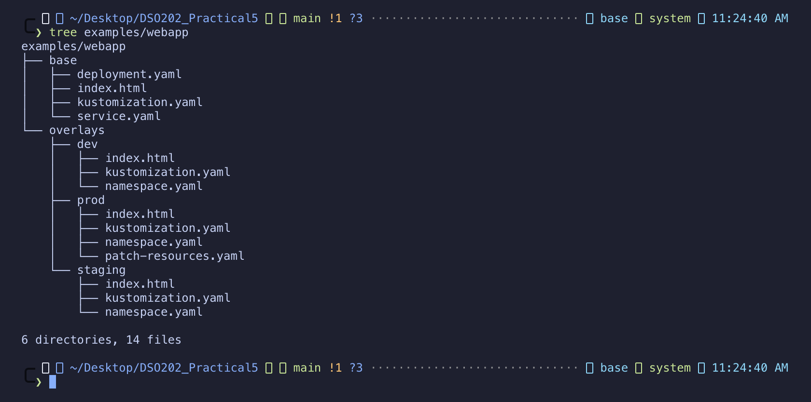

```
examples/webapp
├── base
│   ├── deployment.yaml
│   ├── index.html
│   ├── kustomization.yaml
│   └── service.yaml
└── overlays
    ├── dev
    │   ├── index.html
    │   ├── kustomization.yaml
    │   └── namespace.yaml
    ├── prod
    │   ├── index.html
    │   ├── kustomization.yaml
    │   ├── namespace.yaml
    │   └── patch-resources.yaml
    └── staging
        ├── index.html
        ├── kustomization.yaml
        └── namespace.yaml
```

**1. Which files exist only once for all environments?**
`base/deployment.yaml`, `base/service.yaml`, `base/kustomization.yaml` and the default `base/index.html`. Every environment builds on these same files.

**2. Which values differ between environments?**

| Value | dev | staging | prod |
|---|---|---|---|
| Namespace | `webapp-dev` | `webapp-staging` | `webapp-prod` |
| `environment` label | `dev` | `staging` | `prod` |
| Replicas | 1 | 2 | 3 |
| Image tag | `1.27-alpine` | `1.27.3-alpine` (pinned) | `1.27.3-alpine` (pinned) |
| Web page | development page | staging page | production page |
| Resources | base values | base values | patched (`patch-resources.yaml`) |
| Annotations | – | – | `training.example.com/change-policy: approval-required` |

**3. Where are those differences represented?**
Only in `overlays/<env>/`: in the overlay's `kustomization.yaml` fields (`namespace`, `labels`, `replicas`, `images`, `commonAnnotations`, `configMapGenerator` with `behavior: replace`), in the overlay's own `index.html`, and for prod in `patch-resources.yaml`.

The base kustomization:

```yaml
resources:
  - deployment.yaml
  - service.yaml

labels:
  - pairs:
      app.kubernetes.io/name: webapp
    includeSelectors: true

configMapGenerator:
  - name: web-content
    files:
      - index.html
```

The dev overlay:

```yaml
namespace: webapp-dev

resources:
  - ../../base
  - namespace.yaml

labels:
  - pairs:
      environment: dev
    includeSelectors: false   # env label must not change the immutable selector
    includeTemplates: true    # ...but pods should still carry it

replicas:
  - name: webapp
    count: 1

images:
  - name: nginx
    newTag: 1.27-alpine

configMapGenerator:
  - name: web-content
    behavior: replace         # swap the base page for the dev page
    files:
      - index.html
```

---

## 7. Task 2 – Rendering the base

```bash
kubectl kustomize examples/webapp/base
kubectl kustomize examples/webapp/base | grep '^kind:'
kubectl kustomize examples/webapp/base | grep 'name: web-content'
```

```
kind: ConfigMap
kind: Service
kind: Deployment

  name: web-content-g6667tg6dc          <- the generated ConfigMap
          name: web-content             <- volumeMount name (local to the pod)
          name: web-content-g6667tg6dc  <- REWRITTEN reference in the Deployment volume
        name: web-content               <- volume name (local to the pod)
```

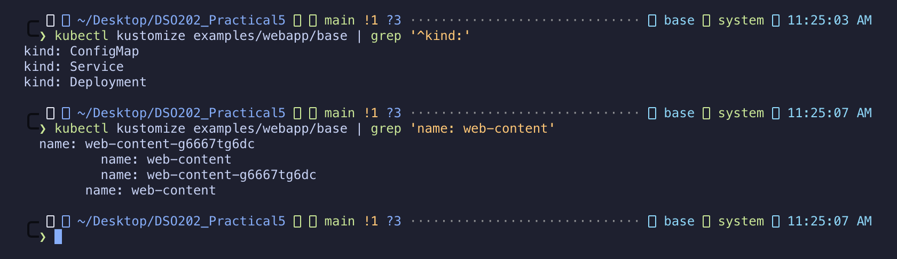

| Item | Found in rendered output |
|---|---|
| Deployment | `kind: Deployment`, `name: webapp` |
| Service | `kind: Service`, `name: webapp` |
| Generated ConfigMap | `kind: ConfigMap`, data key `index.html` |
| Hash suffix | `g6667tg6dc` |
| Rewritten reference | `spec.template.spec.volumes[0].configMap.name: web-content-g6667tg6dc` |

I did **not** apply the base. It has no namespace, so applying it would put the app into `default`.

### Checkpoint – why is the name not exactly `web-content`?

`configMapGenerator` builds the ConfigMap from `index.html` and appends a **hash of its content** to the name (`web-content-g6667tg6dc`). This makes the ConfigMap effectively **immutable**: different content gives a different name. Kustomize knows that `deployment.spec.template.spec.volumes[].configMap.name` is a reference to a ConfigMap, so it rewrites `web-content` to the hashed name automatically. In `deployment.yaml` I only ever write `web-content`.

Full render: [evidence/02-base-render.yaml](evidence/02-base-render.yaml)

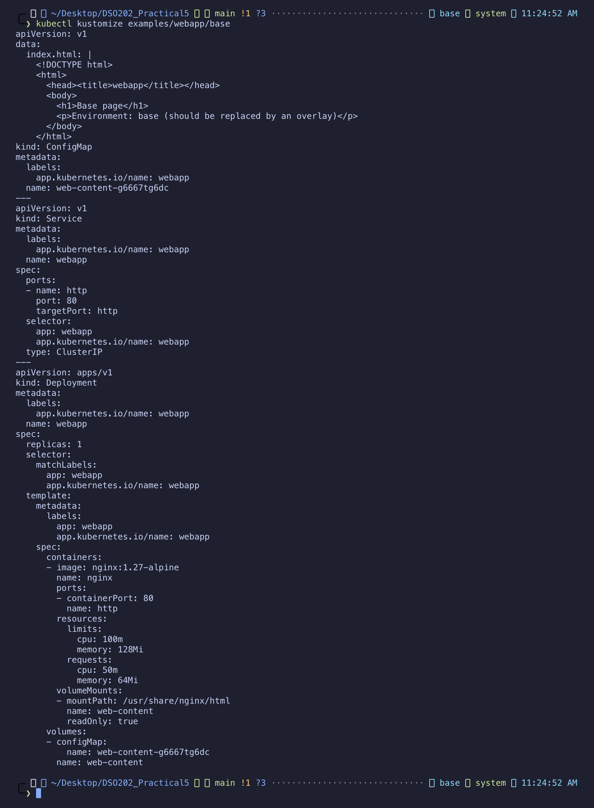

---

## 8. Task 3 – Comparing dev and prod without touching the cluster

```bash
kubectl kustomize examples/webapp/overlays/dev  > /tmp/webapp-dev.yaml
kubectl kustomize examples/webapp/overlays/prod > /tmp/webapp-prod.yaml
diff -u /tmp/webapp-dev.yaml /tmp/webapp-prod.yaml || true
```

Excerpt of the diff (full diff: [evidence/03-dev-vs-prod.diff](evidence/03-dev-vs-prod.diff)):

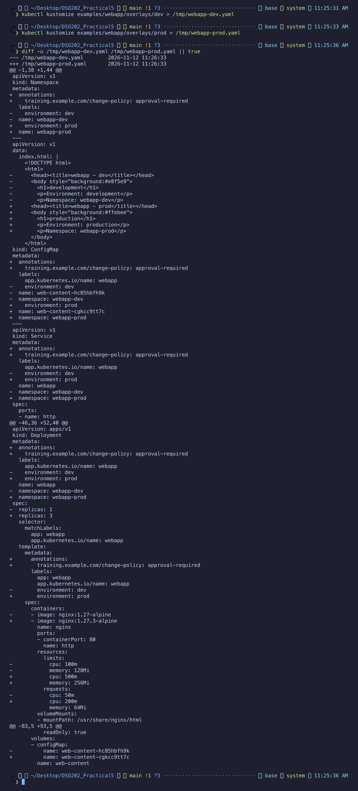

```diff
 kind: Deployment
 metadata:
+  annotations:
+    training.example.com/change-policy: approval-required
   labels:
     app.kubernetes.io/name: webapp
-    environment: dev
+    environment: prod
   name: webapp
-  namespace: webapp-dev
+  namespace: webapp-prod
 spec:
-  replicas: 1
+  replicas: 3
 ...
-      - image: nginx:1.27-alpine
+      - image: nginx:1.27.3-alpine
 ...
           limits:
-            cpu: 100m
-            memory: 128Mi
+            cpu: 500m
+            memory: 256Mi
           requests:
-            cpu: 50m
+            cpu: 200m
             memory: 64Mi
 ...
       - configMap:
-          name: web-content-hc85hbfh9k
+          name: web-content-cgkcc9tt7c
```

**Environment differences identified (7):**

1. **Namespace:** `webapp-dev` → `webapp-prod` (on every object, plus the Namespace itself).
2. **Environment label:** `environment: dev` → `environment: prod`.
3. **Replica count:** `1` → `3`.
4. **Image tag:** `nginx:1.27-alpine` → `nginx:1.27.3-alpine` (the `images` transformer).
5. **Resource requests/limits:** CPU request 50m → 200m, limits 100m/128Mi → 500m/256Mi.
6. **Generated web content:** different `index.html`, so a different ConfigMap hash (`hc85hbfh9k` vs `cgkcc9tt7c`), and the volume reference follows it.
7. **Annotations:** prod adds `training.example.com/change-policy: approval-required` to all resources and the pod template.

> **Principle:** I can explain all seven differences by reading about 40 lines of overlay files, instead of comparing two complete copies of the manifests.

---

## 9. Task 4 – Deploying dev safely

```bash
kubectl kustomize examples/webapp/overlays/dev         # 1. render / inspect
kubectl diff -k examples/webapp/overlays/dev || true   # 2. diff
kubectl apply -k examples/webapp/overlays/dev          # 3. apply
kubectl get all -n webapp-dev                          # 4. verify
kubectl get configmap -n webapp-dev
kubectl rollout status deployment/webapp -n webapp-dev
```

Rendered dev output (full: [evidence/03-render-dev.yaml](evidence/03-render-dev.yaml)):

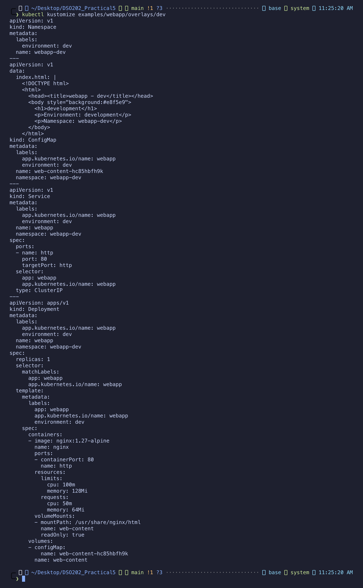

Excerpt:

```yaml
apiVersion: v1
kind: Namespace
metadata:
  labels:
    environment: dev
  name: webapp-dev
---
kind: ConfigMap
metadata:
  labels:
    app.kubernetes.io/name: webapp
    environment: dev
  name: web-content-hc85hbfh9k
  namespace: webapp-dev
---
kind: Deployment
metadata:
  name: webapp
  namespace: webapp-dev
spec:
  replicas: 1
  template:
    spec:
      containers:
      - image: nginx:1.27-alpine
      volumes:
      - configMap:
          name: web-content-hc85hbfh9k
```

Apply:

```
namespace/webapp-dev created
configmap/web-content-hc85hbfh9k created
service/webapp created
deployment.apps/webapp created
deployment "webapp" successfully rolled out
```

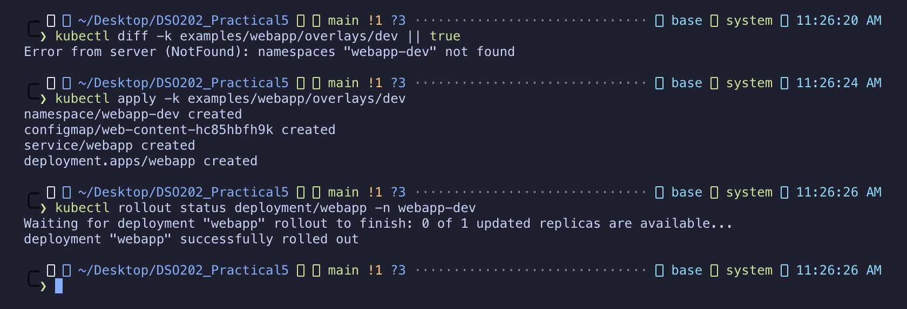

`kubectl get all -n webapp-dev`:

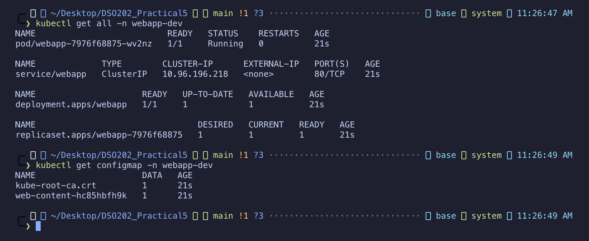

```
NAME                          READY   STATUS    RESTARTS   AGE
pod/webapp-7976f68875-wv2nz   1/1     Running   0          21s

NAME             TYPE        CLUSTER-IP      EXTERNAL-IP   PORT(S)   AGE
service/webapp   ClusterIP   10.96.196.218   <none>        80/TCP    21s

NAME                     READY   UP-TO-DATE   AVAILABLE   AGE
deployment.apps/webapp   1/1     1            1           21s

NAME                                DESIRED   CURRENT   READY   AGE
replicaset.apps/webapp-7976f68875   1         1         1       21s

NAME                     DATA   AGE
kube-root-ca.crt         1      21s
web-content-hc85hbfh9k   1      21s
```

The Deployment keeps the base name `webapp`. Only the **namespace** separates the environment.

---

## 10. Task 5 – Reaching the application

```bash
kubectl port-forward -n webapp-dev service/webapp 8080:80
# in another terminal
curl http://127.0.0.1:8080
```

```html
<html>
  <head><title>webapp - dev</title></head>
  <body style="background:#e8f5e9">
    <h1>development</h1>
    <p>Environment: development</p>
    <p>Namespace: webapp-dev</p>
  </body>
</html>
```

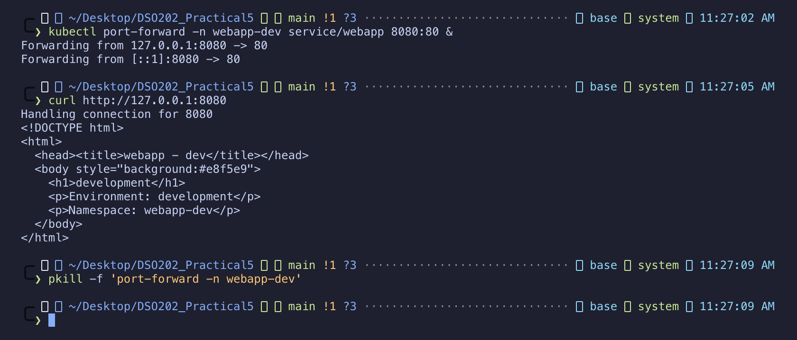

The response identifies the **development** environment, so the dev overlay's `index.html` replaced the base page. I stopped the port-forward afterwards.

---

## 11. Task 6 – Proving the ConfigMap hash → rollout chain

**Before** ([evidence/06a-before.txt](evidence/06a-before.txt)):

```
NAME                     DATA   AGE
web-content-hc85hbfh9k   1      34s

NAME                      READY   STATUS    NODE
webapp-7976f68875-wv2nz   1/1     Running   dso202-worker2
```

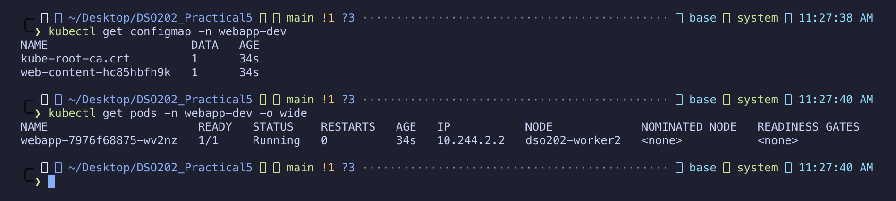

I changed `examples/webapp/overlays/dev/index.html`:

```html
<h1>DEV v2 — configuration changed</h1>
```

Then I **rendered again before applying**:

```
$ kubectl kustomize examples/webapp/overlays/dev | grep 'name: web-content'
  name: web-content-4m4f87g697
          name: web-content-4m4f87g697
```

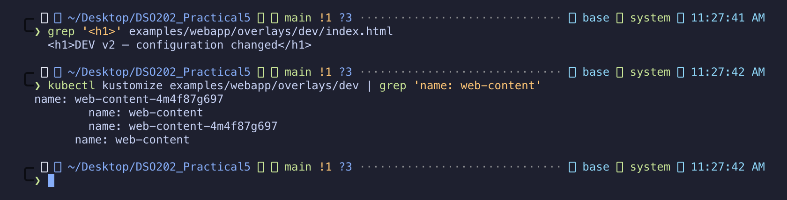

The render already showed the new hash in both the ConfigMap and the Deployment reference. Then I applied it:

```
namespace/webapp-dev unchanged
configmap/web-content-4m4f87g697 created
service/webapp unchanged
deployment.apps/webapp configured
deployment "webapp" successfully rolled out
```

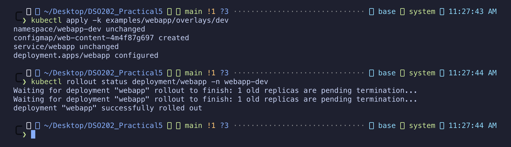

**After** ([evidence/06e-after.txt](evidence/06e-after.txt)):

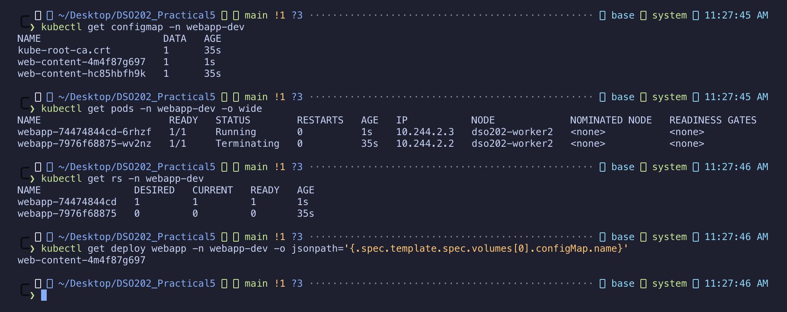

```
NAME                     DATA   AGE
web-content-4m4f87g697   1      1s     <- new
web-content-hc85hbfh9k   1      35s    <- old one is left behind

NAME                      READY   STATUS        AGE
webapp-74474844cd-6rhzf   1/1     Running       1s     <- new pod
webapp-7976f68875-wv2nz   1/1     Terminating   35s    <- old pod

NAME                DESIRED   CURRENT   READY
webapp-74474844cd   1         1         1
webapp-7976f68875   0         0         0
```

| | Before | After |
|---|---|---|
| ConfigMap | `web-content-hc85hbfh9k` | `web-content-4m4f87g697` |
| ReplicaSet | `webapp-7976f68875` | `webapp-74474844cd` |
| Pod | `webapp-7976f68875-wv2nz` | `webapp-74474844cd-6rhzf` |

### The chain in my own words

```
file content changed
→ generated ConfigMap content changed
→ generated ConfigMap name hash changed
→ Deployment reference changed
→ Deployment pod template changed
→ rollout occurred
```

I only edited one line of HTML. Because the hash is calculated from the ConfigMap's content, the new content produced a new name (`hc85hbfh9k` → `4m4f87g697`). Kustomize rewrote the volume reference inside the Deployment's **pod template** to that new name. Kubernetes treats any change to the pod template as a new revision, so the Deployment created a new ReplicaSet (`74474844cd`) and replaced the old pod with a new one through a normal rolling update.

Without the hash, editing a ConfigMap with the same name would *not* restart the pods. They would keep serving the old page (or pick it up at an unpredictable time), and there would be no rollout history to roll back to. The old ConfigMap `hc85hbfh9k` is kept, which is why a `kubectl rollout undo` would still work. However, it is also garbage that `kubectl apply` does not prune by itself.

---

## 12. Task 7 – Deploying staging and prod

```bash
kubectl diff -k examples/webapp/overlays/staging || true
kubectl apply -k examples/webapp/overlays/staging
kubectl diff -k examples/webapp/overlays/prod || true
kubectl apply -k examples/webapp/overlays/prod

kubectl get deploy -A -l app.kubernetes.io/name=webapp
kubectl get pods   -A -l app.kubernetes.io/name=webapp -o wide
```

```
NAMESPACE        NAME     READY   UP-TO-DATE   AVAILABLE   AGE
webapp-dev       webapp   1/1     1            1           79s
webapp-prod      webapp   3/3     3            3           36s
webapp-staging   webapp   2/2     2            2           36s

NAMESPACE        NAME                      READY   STATUS    NODE
webapp-dev       webapp-74474844cd-6rhzf   1/1     Running   dso202-worker2
webapp-prod      webapp-f7598dc6f-6lmbp    1/1     Running   dso202-worker2
webapp-prod      webapp-f7598dc6f-j77rl    1/1     Running   dso202-worker
webapp-prod      webapp-f7598dc6f-qflkp    1/1     Running   dso202-worker
webapp-staging   webapp-7589cb5c57-kftdl   1/1     Running   dso202-worker2
webapp-staging   webapp-7589cb5c57-vlz9p   1/1     Running   dso202-worker
```

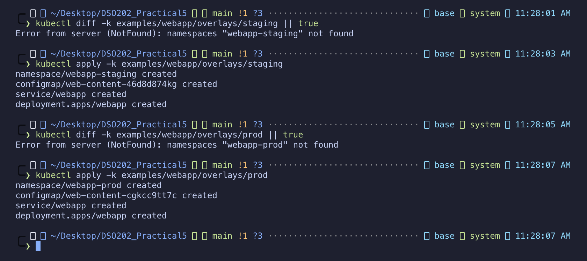

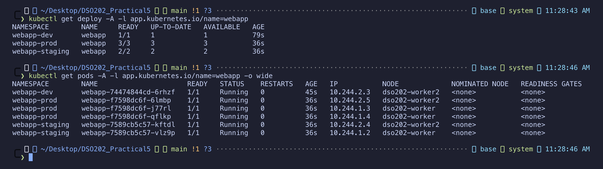

**Replica counts by environment:**

| Environment | Namespace | Replicas |
|---|---|---|
| dev | `webapp-dev` | 1 |
| staging | `webapp-staging` | 2 |
| prod | `webapp-prod` | 3 |

The one label selector `app.kubernetes.io/name=webapp` finds every environment, because that label comes from the shared base.

---

## 13. Task 8 – What the prod patch changed

`overlays/prod/patch-resources.yaml` (a **strategic merge patch**):

```yaml
apiVersion: apps/v1
kind: Deployment
metadata:
  name: webapp
spec:
  template:
    spec:
      containers:
        - name: nginx          # merge key: matches the base container by name
          resources:
            requests:
              cpu: 200m
            limits:
              cpu: 500m
              memory: 256Mi
```

Rendered prod container resources, which I also confirmed on the live cluster:

```
$ kubectl get deploy webapp -n webapp-prod -o jsonpath='{.spec.template.spec.containers[0].resources}'
{"limits":{"cpu":"500m","memory":"256Mi"},"requests":{"cpu":"200m","memory":"64Mi"}}
```

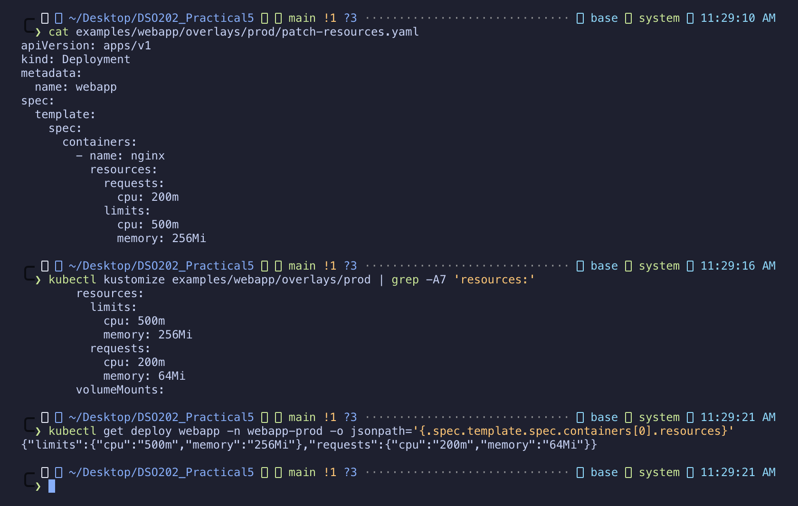

| Field | Base | Patch | Result |
|---|---|---|---|
| requests.cpu | 50m | 200m | **200m** |
| requests.memory | 64Mi | *(not in patch)* | **64Mi** (kept from base) |
| limits.cpu | 100m | 500m | **500m** |
| limits.memory | 128Mi | 256Mi | **256Mi** |

**1. Were the base resource values deleted entirely or merged?**
They were **merged**. The patch does not mention `requests.memory`, and that field kept its base value of `64Mi`. Only the fields I listed were overwritten. The container was matched by its `name: nginx`, so the image, ports and volumeMounts from the base were also kept.

**2. Which environment owns the production-specific resource policy?**
The **prod overlay**. The policy lives only in `overlays/prod/patch-resources.yaml`. The base and the other overlays do not know about it.

**3. Why is a patch better than copying `deployment.yaml` into `prod/`?**
The patch is about 15 lines that show only the *intent* (prod gets more CPU and memory). A copy would be a full second Deployment. Any later base change, such as a new image, a probe or a security fix, would have to be repeated by hand in the copy, and it would drift. With a patch, prod keeps inheriting every base improvement, and a reviewer can see the whole production difference at a glance.

---

## 14. Task 9 – My own QA overlay

Requirements: namespace `webapp-qa`, 2 replicas, label `environment: qa`, a unique page, the same base, and the annotation `training.example.com/owner: qa-team` added with a **JSON 6902 patch**, without copying `deployment.yaml` or `service.yaml`.

```
overlays/qa/
├── index.html
├── kustomization.yaml
├── namespace.yaml
└── patch-annotation.yaml
```

`overlays/qa/kustomization.yaml`:

```yaml
apiVersion: kustomize.config.k8s.io/v1beta1
kind: Kustomization

namespace: webapp-qa

resources:
  - ../../base
  - namespace.yaml

labels:
  - pairs:
      environment: qa
    includeSelectors: false
    includeTemplates: true

replicas:
  - name: webapp
    count: 2

configMapGenerator:
  - name: web-content
    behavior: replace
    files:
      - index.html

patches:
  - path: patch-annotation.yaml
    target:
      group: apps
      version: v1
      kind: Deployment
      name: webapp
```

`overlays/qa/patch-annotation.yaml`:

```yaml
- op: add
  path: /metadata/annotations
  value:
    training.example.com/owner: qa-team
```

`overlays/qa/namespace.yaml`:

```yaml
apiVersion: v1
kind: Namespace
metadata:
  name: webapp-qa
```

`overlays/qa/index.html`:

```html
<!DOCTYPE html>
<html>
  <head><title>webapp - qa</title></head>
  <body style="background:#e3f2fd">
    <h1>qa</h1>
    <p>Environment: quality assurance</p>
    <p>Namespace: webapp-qa</p>
    <p>Owner: qa-team</p>
  </body>
</html>
```

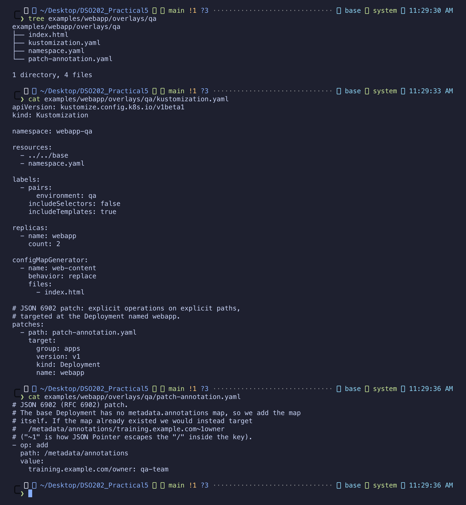

**Render, and do not proceed until the annotation appears:**

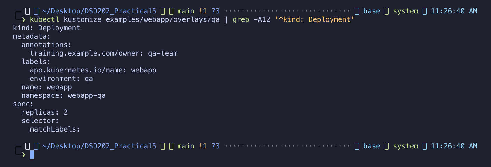

```
$ kubectl kustomize examples/webapp/overlays/qa
...
kind: Deployment
metadata:
  annotations:
    training.example.com/owner: qa-team
  labels:
    app.kubernetes.io/name: webapp
    environment: qa
  name: webapp
  namespace: webapp-qa
spec:
  replicas: 2
```

**Diff, apply and verify:**

```
$ kubectl apply -k examples/webapp/overlays/qa
namespace/webapp-qa created
configmap/web-content-htkgc9bm2g created
service/webapp created
deployment.apps/webapp created

$ kubectl get deployment webapp -n webapp-qa -o jsonpath='{.metadata.annotations.training\.example\.com/owner}'
qa-team

$ kubectl get deploy -A -l app.kubernetes.io/name=webapp
NAMESPACE        NAME     READY   UP-TO-DATE   AVAILABLE   AGE
webapp-dev       webapp   1/1     1            1           2m9s
webapp-prod      webapp   3/3     3            3           86s
webapp-qa        webapp   2/2     2            2           43s
webapp-staging   webapp   2/2     2            2           86s
```

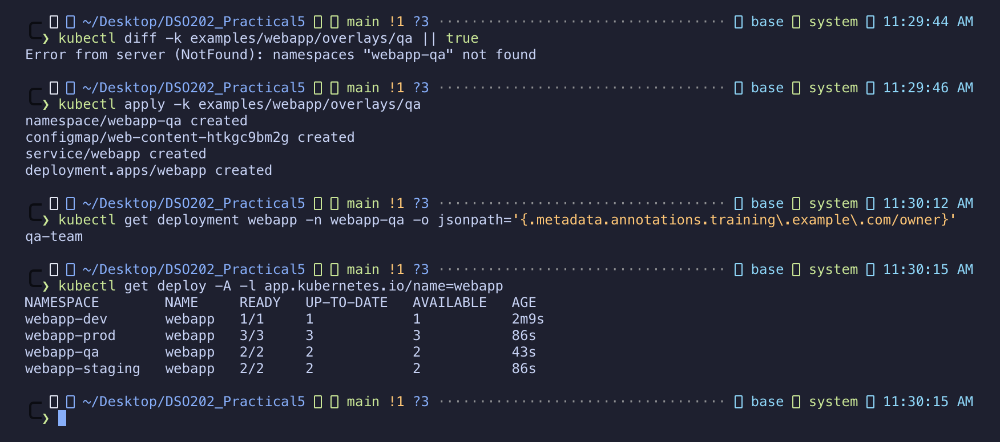

Full live Deployment: [evidence/09f-qa-live-deployment.yaml](evidence/09f-qa-live-deployment.yaml)

---

## 15. Strategic Merge Patch vs JSON 6902 Patch

| | Strategic merge patch (prod) | JSON 6902 patch (QA) |
|---|---|---|
| Looks like | A partial Kubernetes object | A list of operations: `op`, `path`, `value` |
| How it finds the target | `apiVersion`/`kind`/`metadata.name` inside the patch | `target:` (group, version, kind, name) in `kustomization.yaml` |
| Lists | Merged by a key (containers by `name`) | Addressed by index, e.g. `/spec/template/spec/containers/0` |
| Missing parents | Created automatically | `add` fails if the parent path does not exist |
| Operations | Set or merge (delete needs `$patch: delete`) | `add`, `remove`, `replace`, `move`, `copy`, `test` |
| Best for | Changing a few fields "on top of" the base, e.g. resources | Precise surgical edits, removing fields, or kinds Kustomize has no merge schema for (CRDs) |

In short, a **strategic merge** patch says *"here is what part of the object should look like"* and Kubernetes-aware merge rules work out the rest. That is why the prod patch could match the `nginx` container by name and keep `requests.memory`. A **JSON 6902** patch says *"do exactly this operation at exactly this path"*. It is more explicit, but it is not schema-aware, so the path must be exactly right. That is the mistake I made below.

---

## 16. Challenge Extension – `namePrefix` in a sandbox overlay

I created `overlays/sandbox/` with only `namespace`, `namePrefix: sandbox-` and an `environment: sandbox` label. The base and the other overlays were not touched.

**My prediction, written before rendering** ([evidence/10a-sandbox-prediction.txt](evidence/10a-sandbox-prediction.txt)):

| Item | Predicted |
|---|---|
| Deployment name | `webapp` → `sandbox-webapp` |
| Service name | `webapp` → `sandbox-webapp` |
| ConfigMap name | `web-content-<hash>` → `sandbox-web-content-<hash>` |
| Deployment volume → ConfigMap reference | rewritten to `sandbox-web-content-<hash>` |
| Namespace `webapp-sandbox` | not prefixed |
| Volume / volumeMount name `web-content`, container `nginx`, port `http` | not changed (local names, not object references) |
| Labels and selectors (`app: webapp`) | not changed, so the Service still selects the pods |
| Hash suffix | unsure: same `g6667tg6dc` as the base, or different because the name changed? |

**Rendered output:**

```
$ kubectl kustomize examples/webapp/overlays/sandbox | grep -nE 'name:|^kind:'
kind: Namespace
  name: webapp-sandbox                          <- not prefixed
kind: ConfigMap
  name: sandbox-web-content-g6667tg6dc          <- prefixed, SAME hash as base
kind: Service
  name: sandbox-webapp                          <- prefixed
kind: Deployment
  name: sandbox-webapp                          <- prefixed
        name: nginx                             <- unchanged
          name: web-content                     <- volumeMount, unchanged
          name: sandbox-web-content-g6667tg6dc  <- reference rewritten
        name: web-content                       <- volume name, unchanged
```

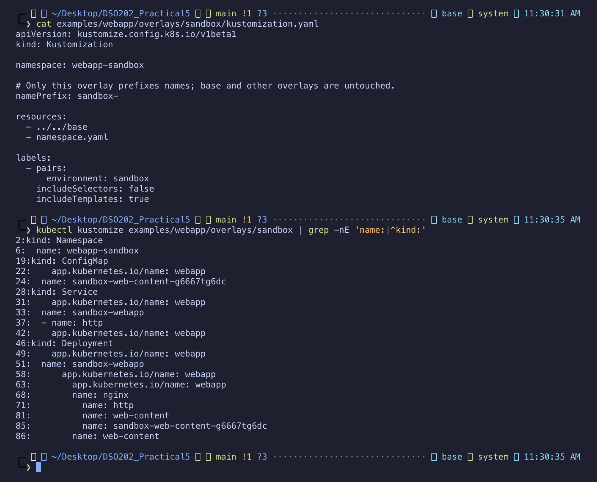

**Comparison:** every prediction was correct. The one open question was answered: the hash stayed `g6667tg6dc`, because the generator computes the hash from the ConfigMap's content **before** the prefix is added, and the content is identical to the base.

The learning point is **reference-aware transformation**. Kustomize did not blindly search and replace "webapp". It knew which fields are *names of objects* (metadata.name, and the `configMap.name` reference) and which are just local names or label values, so the prefixed app still works.

---

## 17. Task 10 – Clean Up

```
$ kubectl delete -k examples/webapp/overlays/dev
namespace "webapp-dev" deleted
configmap "web-content-4m4f87g697" deleted from webapp-dev namespace
service "webapp" deleted from webapp-dev namespace
deployment.apps "webapp" deleted from webapp-dev namespace
$ kubectl delete -k examples/webapp/overlays/staging
...
$ kubectl delete -k examples/webapp/overlays/prod
...
$ kubectl delete -k examples/webapp/overlays/qa
...
$ kubectl get ns | grep 'webapp-' || true
(no output, so no webapp- namespaces remain)
```

`delete -k` only knows about the *current* ConfigMap (`4m4f87g697`). The old `hc85hbfh9k` was still removed, because each overlay contains its Namespace and deleting a namespace deletes everything inside it. The sandbox overlay was only rendered and never applied, so it did not need cleaning up.

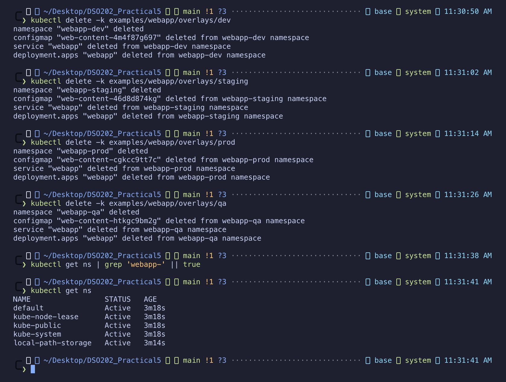

Full output: [evidence/11-cleanup.txt](evidence/11-cleanup.txt)

---

## 18. Reflection – A Kustomize mistake and how rendered output exposed it

My first version of `overlays/qa/patch-annotation.yaml` was:

```yaml
- op: add
  path: /metadata/annotations/training.example.com/owner
  value: qa-team
```

Rendering it failed immediately:

```
$ kubectl kustomize examples/webapp/overlays/qa
error: add operation does not apply: doc is missing path:
"/metadata/annotations/training.example.com/owner": missing value
```

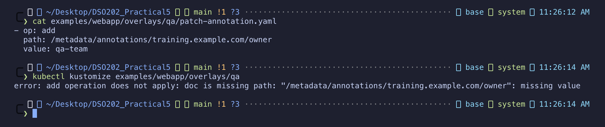

The render exposed two mistakes at once:

1. **The `/` in the key was not escaped.** In a JSON Pointer, `/` separates path segments, so my path meant `annotations` → `training.example.com` → `owner`, a nested map that does not exist. The correct escape for `/` inside a key is `~1` (`training.example.com~1owner`).
2. **The parent did not exist.** The base Deployment has **no** `metadata.annotations` map at all, and JSON 6902 `add` will not create missing parents. A strategic merge patch would have created it.

The fix was to add the whole annotations map in one operation, as shown in section 14. I then re-rendered and only continued once `training.example.com/owner: qa-team` appeared in the Deployment.

Because I followed **render → diff → apply**, this error never reached the cluster. It was caught on my laptop in under a second, which is the main reason to always render first.

---

## 19. Challenges Faced

| Challenge | Solution |
|---|---|
| The JSON 6902 annotation patch failed to render (unescaped `/`, missing parent map) | Read the render error, then added the whole `/metadata/annotations` map. See section 18. |
| `kubectl diff -k` on a brand-new overlay printed `Error from server (NotFound): namespaces "webapp-dev" not found` | `diff` does a server-side dry run, and the namespaced objects cannot be validated before their Namespace exists. This is expected on a first deploy, and `\|\| true` keeps the workflow going. The rendered output is the review for the first deploy, and `diff` works normally afterwards (see Task 6). |
| Adding an `environment` label to selectors would break later changes, because a Deployment's `spec.selector` is immutable | Used `labels:` with `includeSelectors: false` and `includeTemplates: true`, so pods carry the label but selectors stay stable |
| The old hashed ConfigMap (`web-content-hc85hbfh9k`) remained after the rollout | Understood that this is by design (it allows rollback). It was removed when the namespace was deleted. In real use, `kubectl apply --prune` or a GitOps tool such as Argo CD (Practical 4) would clean it up. |
| zsh rejected `echo ===` while I was separating outputs | Cosmetic only; I removed the separator. |

## 20. Conclusion

In this practical I deployed one NGINX application to **four environments** (dev, staging, prod and QA) on a 3-node Kind cluster from a **single base**, without copying a single Deployment or Service. I confirmed that:

- **Overlays describe only the difference.** All seven dev/prod differences fit in a few lines of `kustomization.yaml` plus one small patch.
- **Transformers are reference-aware.** `namespace`, `labels`, `replicas`, `images` and `namePrefix` update names *and* the references to them, as the sandbox challenge showed.
- **ConfigMap hashes drive rollouts.** Changing one line of HTML changed the hash, the pod template and the ReplicaSet, and replaced the pods automatically.
- **Strategic merge vs JSON 6902.** Strategic merge merges into the base (prod kept `requests.memory: 64Mi`), while JSON 6902 performs exact operations and needs exact paths.
- **render → diff → apply → verify** catches mistakes before they reach the cluster. My broken QA patch failed on my laptop, not in production.

Together with Practical 4, this gives a complete picture: Kustomize produces clean, environment-specific YAML from one source, and a GitOps tool such as Argo CD (which understands Kustomize natively) can keep each environment continuously in sync with it.
